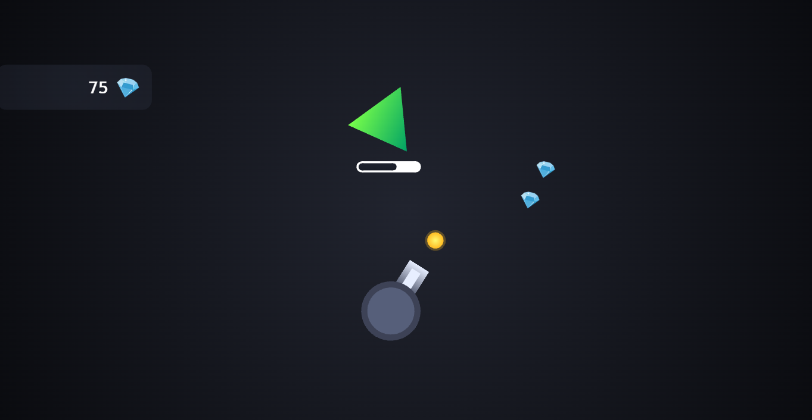
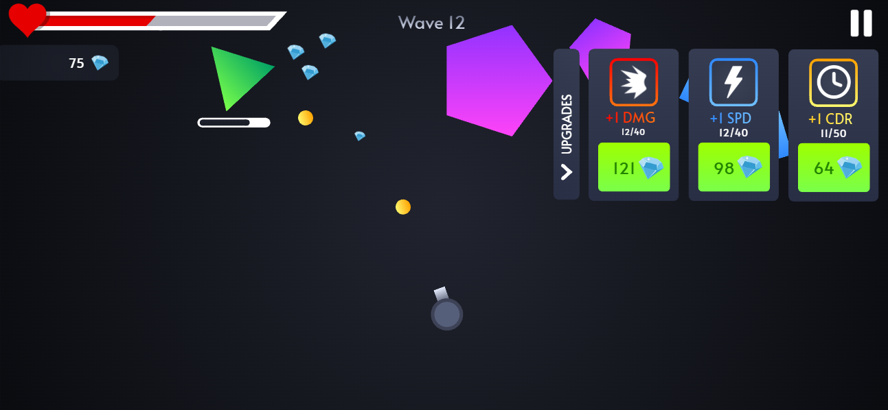
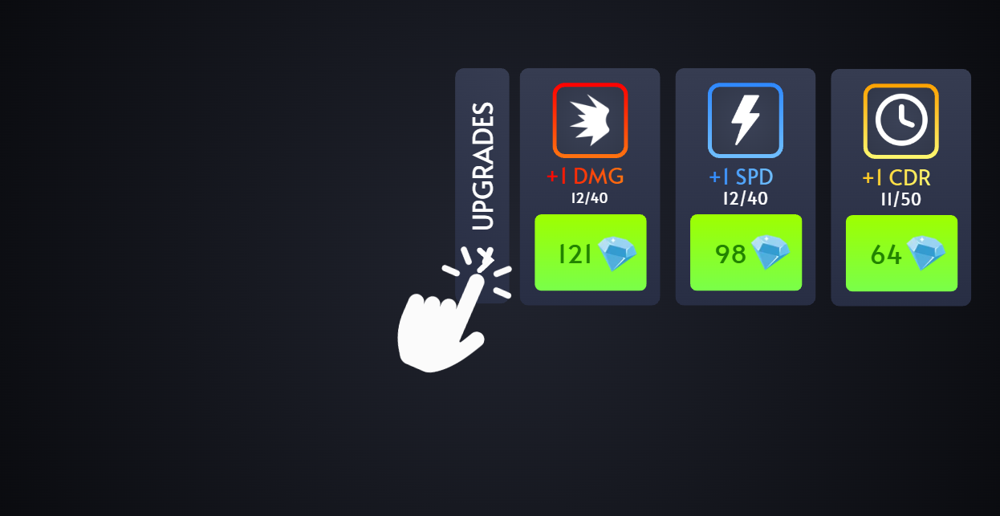
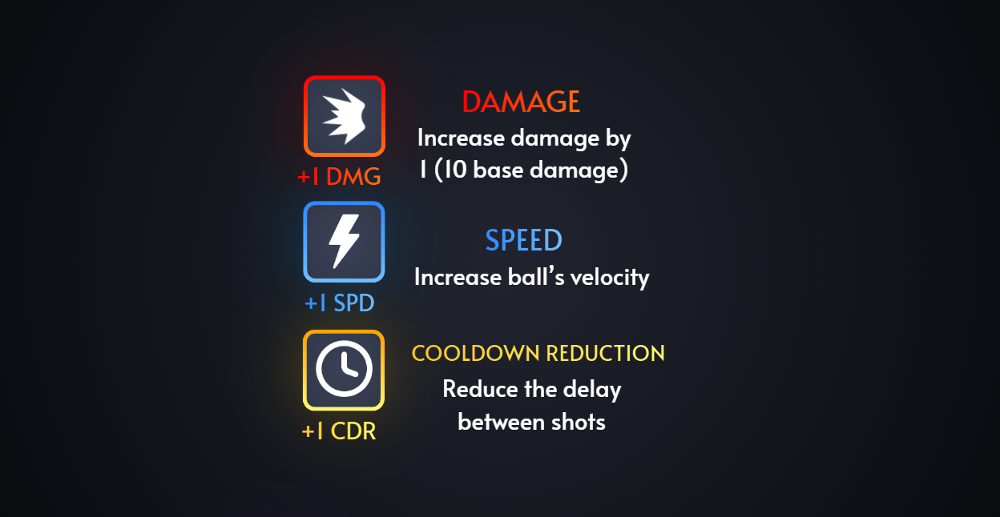
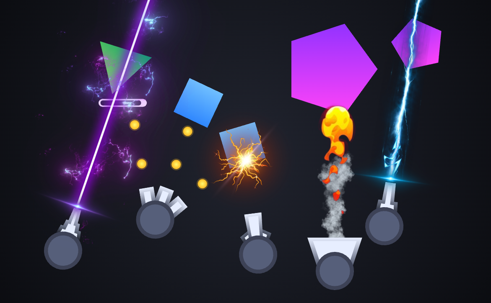

# Shape Madness

**Un shooter d'arcade pour Android dans lequel la visée se fait en faisant pivoter le téléphone.**

Posez le telephone à plat et orientez le pour tirer sur les ennemis ! Le jeu est composé de 50 vagues à difficulté croissante. Faites évoluer votre canon pour améliorer vos dégats.

## Captures d'écran

## Trailer vidéo

[Lien](https://youtu.be/373ZaK_f1AQ)

  
  

  
  

  

## Principe du jeu

- **Visée** : il est possible de viser en faisant pivoter le téléphone tenu à plat, le canon suivant les mouvements grâce au gyroscope.
- **Diamants** : chaque ennemi détruit peut lâcher des diamants, qui servent de monnaie.
- **Améliorations** : l'onglet *UPGRADES* permet de dépenser les diamants pour renforcer le canon.
- **Santé** : le jeu commence avec 100 points de vie, attention à ne pas prendre trop de dégats !
- **Classes** : une évolution peut être choisie après la vague 10, puis une 2ème évolution après la vague 20.

## Specifications technique

- **Langage** : Kotlin
- **Plateforme** : Android
- **Capteur requis** : gyroscope
- **Orientation** : paysage uniquement
- **Langue de l'interface** : anglais
- **Environnement de développement** : Android Studio
Le projet n'utilise aucune bibliothèque externe : tout repose sur le SDK Android.

## Installation

1. Cloner le dépôt :
   `git clone https://github.com/Taksy01/Shape_Madness`
2. Ouvrir le projet dans Android Studio
3. Lancer l'application sur un téléphone (le jeu se base sur le gyroscope, il n'est pas jouable correctement sur émulateur)

## Évolutions prévues

- Mode **Sandbox** permettant de tester librement toutes les armes
